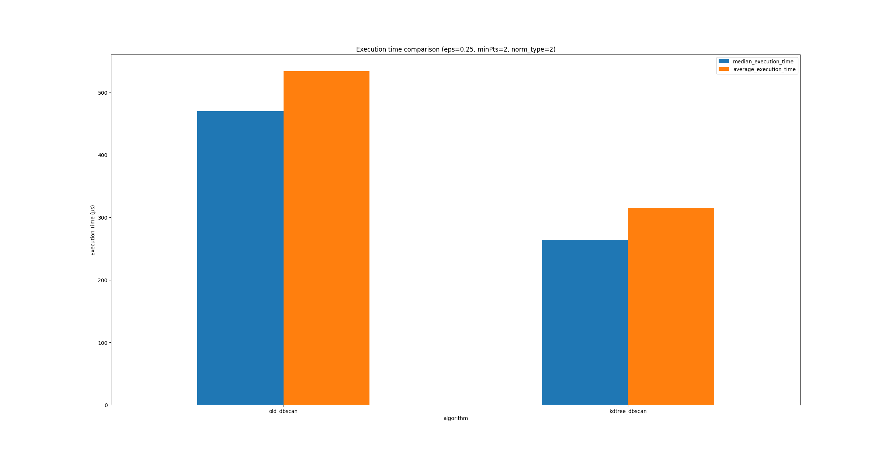

# DBSCAN-KDTree

A personal showcase of my work evaluating clustering algorithms for autonomous racing in Formula Student.

## Project context

The goal of the original project was to find an effective way to cluster LiDAR points for an autonomous Formula Student race car. The input points come from a 3D LiDAR sensor and are first filtered with ground removal. Clustering is then used to identify the cones that delimit the track.

The team's original implementation used a straightforward DBSCAN algorithm. We tested multiple approaches to find the best fit for our setup and the average number of points processed at the time. A KD-tree-based approach performed best in those tests, so I developed and evaluated KD-tree implementations for the project. The system was intended to run on an NVIDIA Jetson Orin.

## Original project

The KD-tree work and its surrounding project are part of [Peace44/DBSCAN](https://github.com/Peace44/DBSCAN), specifically the [`KDTREE_DBSCAN`](https://github.com/Peace44/DBSCAN/tree/basic_optimized/KDTREE_DBSCAN) directory on the `basic_optimized` branch.

This repository is a personal showcase of that work. Benchmark results depend on the dataset, algorithm configuration, and hardware; comparisons should use the same inputs and settings when reporting performance.

## Results


The plot below compares the original DBSCAN implementation with the KD-tree-based implementation. It shows median and average execution times for the benchmark configuration `eps=0.25`, `minPts=2`, and Euclidean distance (`norm_type=2`).
The average execution time decreased by approximately 50%.



## KD-tree DBSCAN parameters

The implementation accepts the following command-line arguments:

```text
kdtree_dbscan <input_filename> <eps> <min_pts> <norm_type>
```

- `input_filename`: CSV file containing 3D points as `x,y,z` columns. The first line is treated as a header.
- `eps`: Neighborhood radius. Points within this distance are considered neighbors. For Euclidean distance, pass the radius itself; the implementation squares it internally to compare squared distances.
- `min_pts`: Minimum number of points in the `eps` neighborhood for a point to be a core point. The point itself is included in this count.
- `norm_type`: Distance metric: `1` for Manhattan (L1), `2` for Euclidean (L2), or `inf` for Chebyshev (L-infinity).

The KD-tree leaf size is set to `10` in the implementation. This controls how many points are stored in a leaf node; it is an index construction setting, not a DBSCAN clustering threshold.
